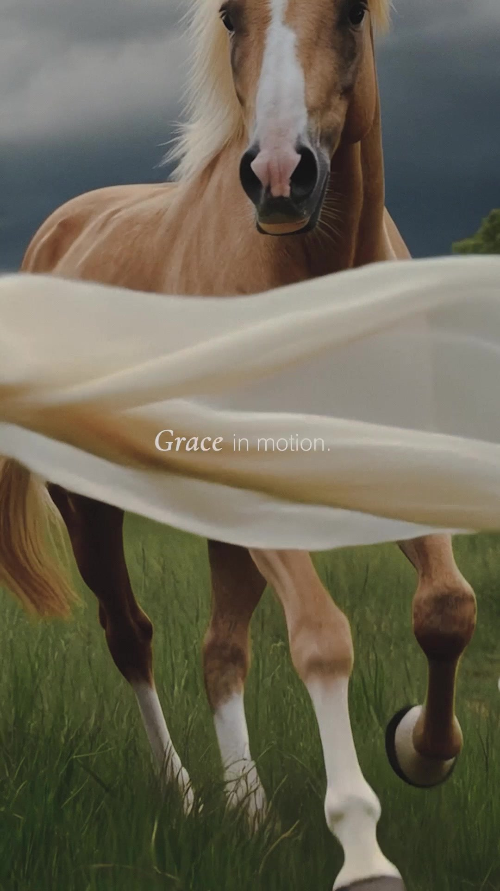
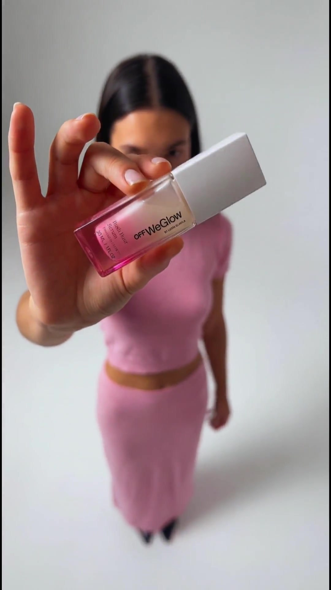
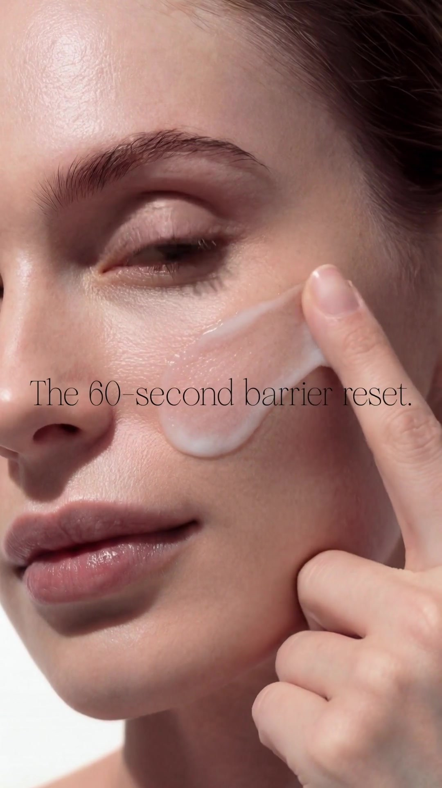

This post is the reference for writing on the KloutKrew blog. Open its source file, `content/blog/how-to-publish-a-blog-post.md`, next to this page and you'll see exactly which markdown produces which result. It's marked `draft: true`, so it shows up on preview links but never on kloutkrew.in.

## Publishing in three steps

1. Create a new file in `content/blog/`. The file name becomes the address, so `brand-colours-that-sell.md` is published at `kloutkrew.in/blog/brand-colours-that-sell`.
2. Copy the block between the `---` lines at the top of this file, then fill in your title, description, date and category.
3. Put your images in `content/blog/images/your-post-name/`, commit, and push. Vercel builds the site and the post goes live in about a minute.

The blog page, the "Keep reading" suggestions, the sitemap and the RSS feed all update on their own.

## Images

Write a normal markdown image. The text in quotes becomes the caption underneath:



You don't need to resize or compress anything. Upload the biggest, sharpest version you have; the build makes small, fast copies for phones and full-size ones for big screens, in modern formats, and shows a soft blurred preview while each one loads.

Add `{.wide}` after an image to let it break out of the text column. Landscape images work best here; tall portrait images are kept to the height of the screen so readers never have to scroll past one:

{.wide}

Or `{.full}` to run it edge to edge across the screen. Use that sparingly — once per post is plenty.

### Galleries

Wrap images in `::: gallery` and `:::` to place them side by side:

::: gallery


:::

Always fill in the alt text inside the square brackets. Screen readers read it out, and Google uses it to understand the image.

## Text formatting

Use **bold** for the one idea a skimming reader must not miss, and *italics* for emphasis or titles. Links work as usual: [talk to us about a project](/contact-us). Links to other websites open in a new tab automatically.

> Good content doesn't interrupt what people are interested in. It is what they're interested in.
>
> — A pull quote, written with `>` at the start of the line

::: note Tip
Callouts are for side notes the reader shouldn't skip — a definition, a warning, a quick checklist. Start one with `::: note` plus an optional label, and end it with `:::`.
:::

- Bullet lists start with a dash
- Keep each point to a line or two
- Numbered lists start with `1.`

### Tables

| Platform | Best for | Our usual timeline |
|---|---|---|
| Webflow | Marketing sites with rich motion | 2–4 weeks |
| Shopify | Product brands selling online | 3–5 weeks |
| Custom build | Apps, dashboards and MVPs | 6+ weeks |

Wide tables scroll sideways on phones instead of squashing.

## Video

Paste the embed code from YouTube, Vimeo or Loom on its own line and it becomes a responsive player that only loads when the reader scrolls to it. On YouTube, click **Share → Embed** and paste what it gives you:

```html
<iframe src="https://www.youtube-nocookie.com/embed/VIDEO_ID" title="What the video is about" allowfullscreen></iframe>
```

## Before you publish

- Write a **description** of one or two sentences. It appears on the blog page, in Google results, and when the link is shared on LinkedIn or WhatsApp.
- Add a **cover** image if you can. Posts without one get a bold generated cover in brand colours, so nothing ever looks broken.
- Set `featured: true` on the post you want in the big slot at the top of the blog page. Otherwise the newest post goes there.
- Remove `draft: true`, or set it to `false`, when it's ready to go live.
