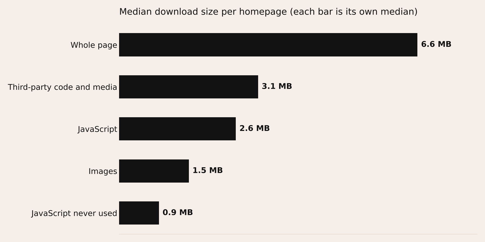
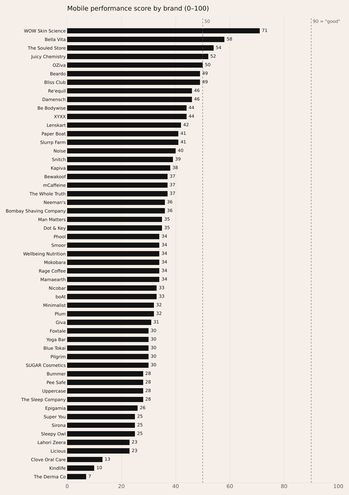

Indian D2C brands spend heavily to get people to their sites, mostly from Instagram and Meta ads on phones. So we measured what those visitors actually wait for. In November 2026 we tested the homepages of **53 well-known Indian D2C brands** with Google's Lighthouse on simulated mobile.

## Key findings

- **None of the 53 homepages scored "good" (90+)** on mobile performance. 48 scored below 50.
- **The median performance score was 34 out of 100.**
- **The main image or headline took about 7.2 seconds** to appear (median Largest Contentful Paint). Google's "good" threshold is 2.5 seconds, and no site met it.
- **The median homepage weighed 6.6 MB** and made 400 requests. 43 of 53 were heavier than 3 MB.
- **JavaScript is the biggest cost:** a median 2.6 MB per page, of which about 0.9 MB was never used on load.
- **Third-party code and media made up about 3.1 MB** per page at the median: apps, analytics, chat, reviews and ad pixels.
- **Layout was stable:** 46 of 53 passed Cumulative Layout Shift, so pages rarely jump around once loaded.
- **SEO basics were mostly in place** (median SEO score 92), but 20 sites had images without alt text and 5 had no meta description.

## Why this matters for D2C brands

Most D2C traffic arrives on a phone, often from a paid click. Every second of blank screen is ad spend that never gets a chance to convert. Google also uses page experience signals in search, and AI shopping assistants increasingly fetch and read product pages, where heavy client-side rendering can hide content.

Speed isn't the only thing that sells a product, and several brands in this list are clearly successful. But the gap between a 30 and a 70 is usually a handful of fixable decisions, not a rebuild.

## Scores by brand

**WOW Skin Science (71)** led the sample by a clear margin, with a 1.9 MB homepage and main content showing in about 2.7 seconds. Bella Vita (58), The Souled Store (54), Juicy Chemistry (52) and OZiva (50) made up the rest of the 50+ group. Bella Vita had the lightest page in the sample at 1.4 MB.

By category, median scores were close together: fashion 39, health 38, beauty 33, food 30 and personal care 28. Slowness is an industry habit, not a category problem.

## What usually causes it

1. **App sprawl.** Shopify apps for reviews, upsells, wishlists, popups and loyalty each add scripts to every page, whether or not the page uses them.
2. **Tag pile-up.** Several analytics tools, ad pixels and heatmaps all loading before the page is usable.
3. **Oversized hero media.** Full-resolution banners and autoplay videos on the first screen, without modern formats or sizing for mobile.
4. **Chat and support widgets** that load their full app on page open instead of when tapped.
5. **Unused theme code.** Themes ship features for every possible store; most stores use a fraction.

## Quick wins we'd try first

- **Audit apps and tags.** Remove what nobody has looked at in 90 days; load the rest after the first interaction where the vendor allows it.
- **Serve the hero image as AVIF or WebP**, sized for phones, with high fetch priority, and don't lazy-load it.
- **Load chat, reviews and recommendation widgets on scroll or tap**, not on page open.
- **Swap the homepage hero video for a poster image** on mobile, or play it only after the page has loaded.
- **Self-host fonts** and limit them to two families and the weights you actually use.
- **Re-test in PageSpeed Insights after every app install.** Treat speed as a budget, not a one-off fix.

If you'd like a second pair of eyes, our [Shopify store design](/shopify-store-design) and [website design](/website-design-agency) teams build fast storefronts, and our [SEO and AI search](/seo-services) work covers Core Web Vitals.

## Full results

Sorted by performance score. LCP is Largest Contentful Paint. Page size and JavaScript are transfer sizes on first load.

| Brand | Category | Score | LCP (s) | Page size (MB) | Requests | JavaScript (MB) |
|---|---|---|---|---|---|---|
| WOW Skin Science | Beauty | 71 | 2.7 | 1.9 | 112 | 0.6 |
| Bella Vita | Beauty | 58 | 5.6 | 1.4 | 121 | 0.1 |
| The Souled Store | Fashion | 54 | 4.0 | 1.9 | 114 | 1.6 |
| Juicy Chemistry | Beauty | 52 | 3.2 | 7.5 | 615 | 3.0 |
| OZiva | Health | 50 | 4.2 | 5.1 | 187 | 0.8 |
| Beardo | Personal care | 49 | 3.5 | 7.2 | 606 | 2.9 |
| Bliss Club | Fashion | 49 | 9.6 | 3.6 | 145 | 1.5 |
| Re'equil | Beauty | 46 | 4.8 | 2.0 | 95 | 1.4 |
| Damensch | Fashion | 46 | 5.8 | 2.3 | 133 | 1.5 |
| XYXX | Fashion | 44 | 5.4 | 2.8 | 232 | 0.6 |
| Be Bodywise | Health | 44 | 7.1 | 2.3 | 120 | 1.5 |
| Lenskart | Eyewear | 42 | 6.0 | 3.4 | 214 | 1.4 |
| Paper Boat | Food | 41 | 6.1 | 9.5 | 59 | 0.1 |
| Slurrp Farm | Food | 41 | 6.2 | 3.4 | 242 | 1.7 |
| Noise | Electronics | 40 | 7.5 | 4.2 | 266 | 1.3 |
| Snitch | Fashion | 39 | 9.8 | 4.7 | 409 | 2.0 |
| Kapiva | Health | 38 | 7.2 | 2.3 | 151 | 1.8 |
| The Whole Truth | Food | 37 | 5.2 | 3.2 | 171 | 2.0 |
| mCaffeine | Beauty | 37 | 6.5 | 3.0 | 209 | 1.1 |
| Bewakoof | Fashion | 37 | 9.4 | 2.6 | 194 | 2.2 |
| Neeman's | Fashion | 36 | 5.8 | 6.5 | 775 | 3.4 |
| Bombay Shaving Company | Personal care | 36 | 6.0 | 6.6 | 572 | 2.9 |
| Man Matters | Health | 35 | 6.1 | 2.5 | 129 | 1.8 |
| Dot & Key | Beauty | 35 | 7.0 | 15.6 | 692 | 4.3 |
| Mamaearth | Beauty | 34 | 5.5 | 7.3 | 584 | 4.2 |
| Rage Coffee | Food | 34 | 6.7 | 8.5 | 388 | 2.8 |
| Wellbeing Nutrition | Health | 34 | 8.6 | 6.8 | 629 | 3.9 |
| Mokobara | Travel | 34 | 8.7 | 21.1 | 676 | 4.9 |
| Phool | Home | 34 | 9.1 | 15.5 | 410 | 2.8 |
| Smoor | Food | 34 | 10.3 | 104.6 | 369 | 3.0 |
| boAt | Electronics | 33 | 7.8 | 7.0 | 607 | 3.7 |
| Nicobar | Fashion | 33 | 13.6 | 19.9 | 517 | 3.8 |
| Plum | Beauty | 32 | 26.4 | 4.8 | 288 | 1.5 |
| Minimalist | Beauty | 32 | 44.4 | 7.4 | 702 | 3.4 |
| Giva | Jewellery | 31 | 14.5 | 15.2 | 739 | 12.2 |
| SUGAR Cosmetics | Beauty | 30 | 6.3 | 29.9 | 460 | 2.3 |
| Yoga Bar | Food | 30 | 6.8 | 6.9 | 640 | 3.6 |
| Foxtale | Beauty | 30 | 9.4 | 4.5 | 273 | 2.5 |
| Blue Tokai | Food | 30 | 10.3 | 34.6 | 596 | 3.0 |
| Pilgrim | Beauty | 30 | 13.7 | 7.9 | 698 | 3.6 |
| Pee Safe | Personal care | 28 | 8.8 | 5.2 | 400 | 2.6 |
| Uppercase | Travel | 28 | 11.5 | 5.6 | 475 | 3.2 |
| Bummer | Fashion | 28 | 13.9 | 11.2 | 626 | 3.4 |
| The Sleep Company | Home | 28 | 15.4 | 19.8 | 491 | 3.4 |
| Epigamia | Food | 26 | 9.6 | 4.1 | 300 | 2.3 |
| Sirona | Personal care | 25 | 10.6 | 7.4 | 637 | 3.7 |
| Super You | Food | 25 | 17.7 | 14.1 | 547 | 3.5 |
| Sleepy Owl | Food | 25 | 33.0 | 6.7 | 414 | 3.2 |
| Lahori Zeera | Food | 23 | 5.4 | 29.0 | 138 | 0.7 |
| Licious | Food | 23 | 33.9 | 4.3 | 742 | 2.5 |
| Clove Oral Care | Personal care | 13 | 5.8 | 7.5 | 473 | 2.2 |
| Kindlife | Beauty | 10 | 6.9 | 4.2 | 196 | 2.6 |
| The Derma Co | Beauty | 7 | 7.8 | 16.0 | 353 | 3.1 |

[Download the full dataset (CSV)](/assets/data/indian-d2c-website-speed-study-2026.csv), including accessibility, best-practice and SEO scores, image and third-party weights.

## Methodology

- **Sample:** 53 well-known Indian direct-to-consumer brands across beauty, food, fashion, health, personal care, home, electronics, travel, eyewear and jewellery. We tested each brand's public homepage only. A 54th site, Wakefit, served our test a bot-check page instead of its homepage, so we left it out.
- **Tool:** Lighthouse 13 in headless Chrome, default mobile settings: simulated mid-range phone, 4x CPU slowdown and slow 4G network.
- **When:** November 2026, one run per site, from a cloud server.
- **Limits:** lab tests vary from run to run, often by 5 to 10 points, and a single run can catch a slow moment. We report medians across the sample for that reason and don't rank brands on small differences. Total Blocking Time is very sensitive to test hardware, so we haven't used it in the headline findings. Real-user (field) data from the Chrome UX Report can differ.
- **Independence:** no brand paid for inclusion or was told about the test in advance.

## Cite this study

KloutKrew Studio (2026). *Indian D2C Website Speed Study 2026: 53 Brands Tested on Mobile.* https://kloutkrew.in/blog/indian-d2c-website-speed-study-2026

Journalists and researchers are welcome to use the charts and data with a link back. For questions or a run on your own site, [get in touch](/contact-us).
